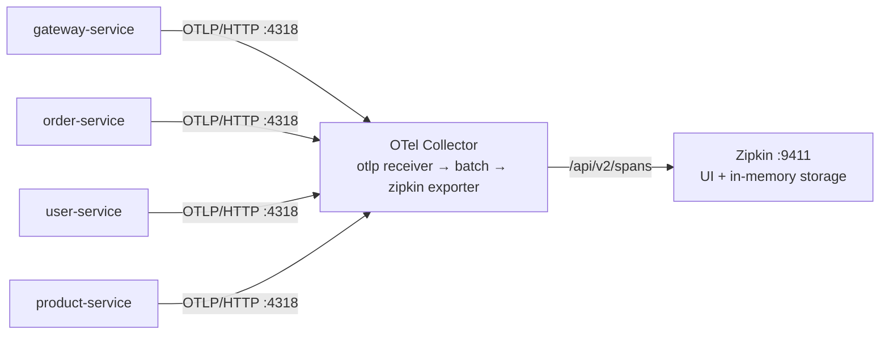

# <span style="color:hsl(13,80%,58%)">zipkin-server</span>

Distributed tracing backend for the service-discovery demo. Not a Maven module (no Java): a Docker
Compose stack with an **OpenTelemetry Collector** in front of **Zipkin**. See the root
[../README.md](../README.md) for the whole picture.

## <span style="color:hsl(151,80%,58%)">How spans get here</span>



- ***Services speak OpenTelemetry, not Zipkin*** — each of `gateway-service`, `user-service`, `order-service`
  and `product-service` has `spring-boot-starter-opentelemetry` (Micrometer Tracing + OTel bridge + OTLP
  exporter). Spans go to `management.opentelemetry.tracing.export.otlp.endpoint`
  (default `http://localhost:4318/v1/traces`, override with `OTLP_TRACES_ENDPOINT`).
- ***The Collector translates*** — Zipkin has no OTLP receiver, so [otel-collector.yaml](otel-collector.yaml)
  receives OTLP (gRPC 4317, HTTP 4318), batches, and exports to Zipkin's `/api/v2/spans`. Swapping Zipkin for
  Jaeger/Tempo is a Collector config change; the services stay as they are.
- ***Propagation*** — W3C `traceparent` header. The gateway's routed calls and order-service's
  load-balanced `RestClient` to user-service (`LoadBalancerConfig` sets the `ObservationRegistry` on it)
  both send it, so `GET /api/orders/101/with-user` through the gateway is one trace across three services.
- ***Sampling 100 %*** — `management.tracing.sampling.probability: 1.0` (Boot's default is 0.1).
- ***Noise filtered*** — each service's `TracingConfig` drops observations for `/actuator/**` (Spring Boot
  Admin polling), `/eureka/**` client calls (registry heartbeats) and Spring Security's per-filter spans.
- ***Log correlation*** — with tracing on, Boot adds `[traceId-spanId]` to every log line, so a trace id from
  Zipkin can be grepped in `logs/*.log`.
- ***Tests*** — `management.tracing.export.enabled: false` in each `application-test.yml`; no Collector needed.

## <span style="color:hsl(288,80%,58%)">Run</span>

```bash
cd zipkin-server
docker compose up -d        # Collector on 4317/4318, Zipkin on 9411
```

Then call something through the gateway and open http://localhost:9411 → ***Run Query***:

```bash
curl -u admin:admin localhost:8080/api/orders/101/with-user
```

Expected trace: `gateway-service` server span → `gateway-service` client span → `order-service`
`http get /api/orders/{id}/with-user` → `order-service` client span → `user-service` `http get /api/users/{id}`.

Start order does not matter: services started before the Collector only log export failures and
drop those spans; nothing else breaks.

| Image | Version | Port |
|---|---|---|
| `otel/opentelemetry-collector-contrib` | 0.130.0 | 4317 (OTLP gRPC), 4318 (OTLP HTTP) |
| `openzipkin/zipkin` | 3.5.1 | 9411 (UI + API) |

## <span style="color:hsl(66,80%,50%)">Gotchas</span>

| Symptom | Cause | Fix |
|---|---|---|
| `Failed to export spans ... Connection refused` in service logs | Collector not running | `docker compose up -d` here |
| Zipkin empty, Collector up | Spans are batched (Boot: 5 s schedule delay, Collector `batch`) | Wait a few seconds, re-run the query |
| Order and user spans in separate traces | A `RestClient`/`WebClient` built without an `ObservationRegistry` sends no `traceparent` | Build it from Boot's builder, or set `.observationRegistry(..)` as `order-service` does |
| Traces gone after restart | Zipkin's in-memory storage | Expected for the demo; Zipkin supports Cassandra/Elasticsearch/MySQL storage |
